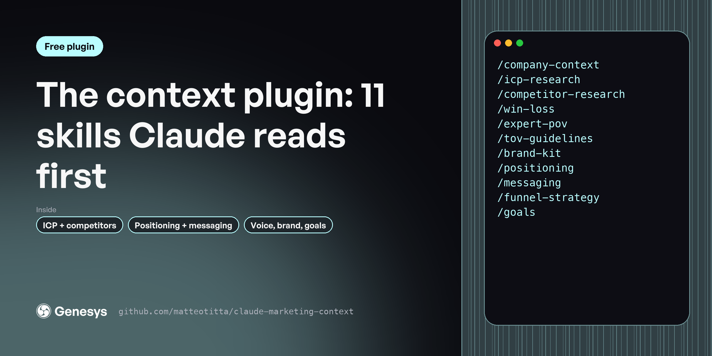

# Marketing context plugin

Claude writes generic copy when it doesn't know your buyer, your competitors or how you sound. These 11 skills build that context once, as files every other skill reads first. For in-house marketers, founders and the agencies working for them.

**Free, MIT licensed. Works in Claude Code, Claude.ai and Cowork.**

---

## Install

In Claude Code:

```
/plugin marketplace add matteotitta/claude-marketing-context
/plugin install marketing-context@claude-marketing-context
```

From your terminal:

```bash
claude plugin marketplace add matteotitta/claude-marketing-context
claude plugin install marketing-context@claude-marketing-context
```

In Claude.ai or Cowork: download [`claude-marketing-context.zip`](https://github.com/matteotitta/claude-marketing-context/releases/latest) and upload it under *Customize → Plugins → Upload plugin*.

---

## Skills

| Skill | What it does |
|---|---|
| `/brand-kit` | Extracts a company's visual identity from screenshots or its website and writes a DESIGN.md brand file. |
| `/company-context` | Researches a company from its website and public sources and writes a company profile. |
| `/competitor-research` | Researches one B2B SaaS competitor across 13 dimensions and writes a sourced dossier with an executive summary, a threat level, strengths and… |
| `/expert-pov` | Draws out a founder's or expert's point of view. |
| `/funnel-strategy` | Works out a company's go-to-market motion from its website and pricing, then maps the funnel stage by stage. |
| `/goals` | Turns a target someone has already committed to into a plan the team can measure. |
| `/icp-research` | Builds an ideal customer profile from evidence: case studies, testimonials, customer logos, solutions pages, reviews and any sales notes you have. |
| `/messaging` | Builds a product messaging library from your positioning, your website and customer evidence. |
| `/positioning` | Develops B2B SaaS positioning from your ICP, competitor and win-loss evidence. |
| `/tov-guidelines` | Extracts a company's tone of voice from its own content and turns it into rules a writer or an AI can follow. |
| `/win-loss` | Analyses sales call transcripts (and churn or renewal calls) to find why deals are won, lost, kept or churned. |

**Start here:** `/company-context → /icp-research → /competitor-research → /positioning → /messaging`

---

## Works best with your context

Every skill reads your context files before it writes: `context/icp/`, `context/positioning/`, `context/messaging/`, `context/brand/` and the rest. If a file is missing, the skill asks you or tells you what it's working without.

The quickest way to set those folders up is a free workspace template:

- [repo-structure-in-house](https://github.com/matteotitta/repo-structure-in-house) for one company
- [repo-structure-agency](https://github.com/matteotitta/repo-structure-agency) for agencies and consultants (swap `context/` for `clients/<client>/context/`)

---

## What the full version adds

These are free, shortened versions of skills from [Marketing Engineering University](https://maven.com/matteo-tittarelli/marketing-engineering-university-genesys-growth). The course versions add the reference material, worked examples and output templates these leave out, plus agents and hooks that chain the skills and check their own work. Week 2 of Marketing Engineering University turns this context into one positioning core that every asset argues from.

## More free plugins

- [Product launch plugin](https://github.com/matteotitta/claude-marketing-launch)
- [Website plugin](https://github.com/matteotitta/claude-marketing-website)
- [AEO plugin](https://github.com/matteotitta/claude-marketing-aeo)
- [LinkedIn plugin](https://github.com/matteotitta/claude-marketing-linkedin)
- [Content plugin](https://github.com/matteotitta/claude-marketing-content)
- [Build your own GTM skills](https://github.com/matteotitta/gtm-skill-template)

---

Built by [Matteo Tittarelli](https://www.linkedin.com/in/matteotittarelli/) at [Genesys Growth](https://genesysgrowth.com). MIT licensed.
